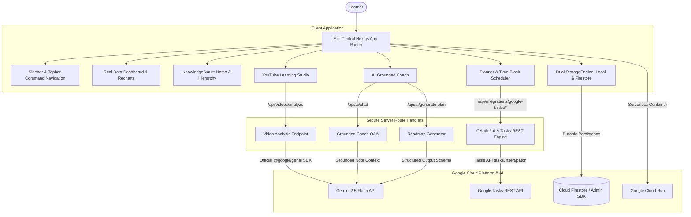

# SkillCentral — Implementation & Architecture Plan

## 1. Product Vision & Architecture
SkillCentral is an AI-powered personal learning command center (a "second brain" for lifelong students and professionals).
Workflow: **Capture → Organize → Understand → Act → Improve**.

---

## 2. Completed Phase Deliverables

### Phase 1: Project Scaffolding & Design System
- [x] Initialized Next.js 16 (App Router, TypeScript, Tailwind CSS, Lucide icons, Recharts, Framer Motion).
- [x] Implemented exact design tokens:
  - Canvas: `#F6F8FC`
  - Cards: `#FFFFFF` (18-24px radius, soft shadows)
  - Typography: `Sora` (headings) + `Inter` (body) from Google Fonts
  - Accent: `#6658F5` (AI accent) and `#20C997` (Mint accent)
  - 5 Sector Color Tokens: Academics `#7566F1`, Language Learning `#19B7A3`, Specialization `#3B82F6`, Hobbies `#F6A54A`, Daily Tasks `#EF6D91`.
- [x] Global Quick Capture Modal (`Ctrl+K` accessible anywhere).
- [x] Responsive layout with collapsible mobile navigation.

### Phase 2: Data Models & Sector Architecture
- [x] Auto-provisioned 5 default configurable sectors on first sign-in.
- [x] Full Sector CRUD (Add, Rename, Recolor, Icon select, Reorder, Archive, Delete with explicit confirmation).
- [x] Preserved Sector IDs across renaming; decoupled Daily Tasks execution stats from knowledge-mastery scores.
- [x] Dual-engine StorageEngine supporting persistent Cloud Firestore and local durable storage with seamless offline/demo resilience.

### Phase 3: Gemini & YouTube Learning Studio
- [x] Server endpoint `/api/videos/analyze` with official `@google/genai` SDK and Gemini 2.5 Flash model.
- [x] Secure URL extraction & normalization (watch, youtu.be, embed, shorts).
- [x] Structured JSON schema generation: Overview, Core Concepts, Study Notes, Timestamps, Analogies, 5 Multiple-Choice Questions with explanations, and Action Tasks.
- [x] Interactive actions: Save to Vault, Take Quiz, Add Tasks to Planner, Ask Gemini Coach.
- [x] Fallback transcript support when direct video streams have quota restrictions.

### Phase 4: Interactive Quiz, Real-Time Analytics & Streak Engine
- [x] Interactive 5-question quiz runner with immediate scoring, rationales, and celebratory confetti.
- [x] Measured Learning Streak derived strictly from qualifying local calendar day activities.
- [x] Measured Mastery derived from real recorded quiz attempts (never fabricated numbers).
- [x] Real-time Recharts:
  - Sector Growth multi-series AreaChart (7/30/90d filter).
  - Learning Activity stacked minutes chart.
  - Skill Balance RadarChart.
  - 14-day Weekly Consistency strip.

### Phase 5: Planner & Google Tasks OAuth 2.0 Flow
- [x] Internal task CRUD working without OAuth (Today/Week/Upcoming views, priority, time-block scheduling).
- [x] True server-side Google OAuth 2.0 authorization-code flow with CSRF state protection:
  - `/api/integrations/google-tasks/connect`
  - `/api/integrations/google-tasks/callback`
  - `/api/integrations/google-tasks/sync`
- [x] Task push (`tasks.insert`), status patch (`tasks.patch`), deduplication via stored `externalTaskId`.
- [x] Preserved granular time blocks, respecting Google Tasks API's date-only RFC 3339 storage limitation.

### Phase 6: AI Coach Grounded Chat & Roadmaps
- [x] Conversational chat interface with 6 specialized modes (*Explain Simply*, *Brainstorm*, *Make Study Plan*, *Quiz Me*, *Summarize Sources*, *Explain My Progress*).
- [x] Grounded Q&A citing user's saved notes in Knowledge Vault with transparent citations.
- [x] Structured 30-day roadmap plan generation with milestone preview and 1-click confirmation into the Planner.

---

## 3. Production Deployment
- **Cloud Run Deployment**: `Dockerfile` (multi-stage standalone Next.js build), `deploy-cloudrun.sh`, `deploy-cloudrun.ps1`.
- **Database Security Rules**: `firestore.rules` and `firestore.indexes.json`.
- **Secret Management**: `.env.example` documenting all configuration keys.
