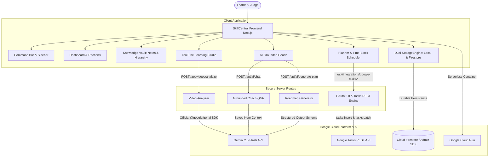

# SkillCentral — AI-Powered Personal Learning Command Center

> Built for the Google Cloud Hackathon. A second brain for lifelong learners combining Gemini 2.5 Flash, Notebook-grounded notes, YouTube Learning Studio, Google Tasks OAuth synchronization, and measured mastery analytics.

[](https://nextjs.org/)
[](https://cloud.google.com/run)
[](https://aistudio.google.com/)
[](https://developers.google.com/tasks)
[](https://firebase.google.com/docs/firestore)

---

## Architecture Overview



---

## Key Features

1. **Measured Learning Dashboard**
   - **Empirical KPIs**: Learning streak calculated from consecutive qualifying local-calendar day events, focus hours logged from the focus timer, and mastery derived from recorded quiz attempts (never fabricated).
   - **Interactive Recharts**: Multi-series Sector Growth AreaChart (7/30/90d filter), Learning Activity stacked minutes chart, and Skill Balance Radar chart.
   - **14-Day Consistency Strip**: Visual day-by-day streak representation.

2. **Knowledge Vault**
   - Sector > Skill/Subject > Topic > Notes hierarchy.
   - Rich Markdown note editor with auto-save, tags, and source links.
   - **Source-Grounded AI Q&A**: Queries Gemini citing user's saved notes with explicit citations, and transparently acknowledges when facts are not in saved sources.

3. **YouTube Learning Studio**
   - Ingests public YouTube URLs with secure normalization (`watch`, `youtu.be`, `embed`, `shorts`).
   - Generates structured study packs via Gemini 2.5 Flash: Overview, Core Concepts, Detailed Study Notes, Grounded Timestamps, Analogies, 5 Multiple-Choice Questions with explanations, and Action Tasks.
   - Interactive quiz runner with instant scoring, feedback, and celebratory confetti.
   - 1-click **Save to Vault** and **Add Tasks to Planner**.

4. **Planner & Google Tasks Read-Only Integration**
   - Built-in task CRUD works standalone without OAuth.
   - Today, Week, and Upcoming calendar views with local time-block scheduling (`10:00 - 11:30`).
   - Server-side **Google OAuth 2.0 authorization-code flow** with secure random CSRF protection and automatic token refresh.
   - Read-only synchronization via `tasks.readonly` scope: live paginated task-list and task browsing.
   - **Architectural safeguard**: Integration is strictly read-only (`push_task` and `patch_task` disabled) to ensure external Google Tasks are never modified or deleted by SkillCentral. Local scheduling operates with full fidelity.

5. **AI Learning Coach**
   - Usable chat interface with 6 specialized modes: *Explain Simply*, *Brainstorm*, *Make Study Plan*, *Quiz Me*, *Summarize Sources*, and *Explain My Progress*.
   - Generates structured 30-day roadmaps with milestone previews and 1-click confirmation into the Planner.

---

## 90-Second Judge Demo Script

1. **Step 1: Open Dashboard (0:00 - 0:15)**
   - View live dashboard with the 4 empirical KPI cards (Streak, Focus Hours, Tasks, Mastery).
   - Notice the 5 pre-configured configurable sectors (**Academics**, **Language Learning**, **Specialization**, **Hobbies**, **Daily Tasks**).
   - Toggle sectors on the **Sector Growth AreaChart** and view the **Skill Balance Radar**.

2. **Step 2: Quick Capture & Focus Timer (0:15 - 0:30)**
   - Press `Ctrl+K` or click **"+ Quick Capture"** to open the global capture modal.
   - Click the **Timer** button to launch the 25m Pomodoro/Stopwatch focus session.

3. **Step 3: YouTube Learning Studio (0:30 - 0:55)**
   - Click **YouTube Studio** in the sidebar.
   - Paste any educational YouTube URL (or click Analyze with the pre-filled link).
   - Watch Gemini 2.5 Flash synthesize the structured study pack: Overview, Core Concepts, Markdown Notes, Timestamps, and Quiz.
   - Click **"Take 5-Question Quiz"**, answer the interactive questions, and submit to see instant scoring and feedback.
   - Click **"Save to Vault"** and **"Add Tasks to Planner"**.

4. **Step 4: Knowledge Vault Grounded Q&A (0:55 - 1:15)**
   - Navigate to **Knowledge Vault**.
   - See your newly saved note in the hierarchy.
   - In the **Source-Grounded AI Q&A** panel, ask: *"How does Raft handle split brain elections?"*
   - See Gemini reply with verifiable citations `[Source: Note Title]`.

5. **Step 5: Planner & Google Tasks (1:15 - 1:30)**
   - Open **Planner & Tasks** to see scheduled time blocks.
   - Check the **Google Tasks** integration status or click **Connect with Google Tasks** to authenticate via OAuth 2.0.

---

## Getting Started Locally

### Prerequisites
- Node.js 18+ (tested on Node.js v25)
- npm 9+

### 1. Clone & Install
```bash
git clone <repo-url>
cd "Google Hackthon"
npm install
```

### 2. Environment Configuration
Copy `.env.example` to `.env.local`:
```bash
cp .env.example .env.local
```

Configure your credentials:
```env
# Google Gemini API Key (Get free key from https://aistudio.google.com/)
GEMINI_API_KEY=your_gemini_api_key_here
GEMINI_MODEL=gemini-2.5-flash

# Google OAuth 2.0 (for Google Tasks integration)
GOOGLE_OAUTH_CLIENT_ID=your_client_id.apps.googleusercontent.com
GOOGLE_OAUTH_CLIENT_SECRET=your_client_secret
GOOGLE_OAUTH_REDIRECT_URI=http://localhost:3000/api/integrations/google-tasks/callback

# Demo Mode (runs out of the box with resilient fallbacks if keys are absent)
DEMO_MODE=true
```

### 3. Run Development Server
```bash
npm run dev
```
Open **[http://localhost:3000](http://localhost:3000)** in your browser.

### 4. Run Automated Tests
```bash
npm test
```
Runs 14 unit tests covering YouTube URL extraction, streak calculation, quiz accuracy, and Google Tasks read-only OAuth, CSRF security, write disabling, and pagination.

---

## Google Cloud Setup Guide

### 1. Gemini API Key
1. Visit [Google AI Studio](https://aistudio.google.com/).
2. Click **Get API key** and create a key in your project.
3. Paste into `GEMINI_API_KEY` in `.env.local`.

### 2. Google Tasks OAuth 2.0 Setup
1. In [Google Cloud Console](https://console.cloud.google.com/), enable the **Google Tasks API**.
2. Go to **APIs & Services → OAuth consent screen**:
   - User Type: **External**
   - Scopes: Add `https://www.googleapis.com/auth/tasks.readonly` and `https://www.googleapis.com/auth/userinfo.email`
   - Test Users: Add your personal Gmail account (required while app is in testing).
3. Go to **APIs & Services → Credentials**:
   - Create Credentials → **OAuth client ID** → Application type: **Web application**.
   - Authorized redirect URIs: `http://localhost:3000/api/integrations/google-tasks/callback` (and your Cloud Run URL in production).
4. Save the Client ID and Client Secret into `.env.local`.

### 3. Deploying to Google Cloud Run

#### Using PowerShell (Windows)
```powershell
.\deploy-cloudrun.ps1 -ProjectId "YOUR_GCP_PROJECT_ID"
```

#### Using Bash (Linux / macOS / Cloud Shell)
```bash
chmod +x deploy-cloudrun.sh
./deploy-cloudrun.sh
```

#### Manual gcloud Commands
```bash
# Enable required APIs
gcloud services enable run.googleapis.com cloudbuild.googleapis.com secretmanager.googleapis.com

# Build and deploy
gcloud builds submit --tag gcr.io/YOUR_PROJECT_ID/skillcentral:latest
gcloud run deploy skillcentral \
  --image gcr.io/YOUR_PROJECT_ID/skillcentral:latest \
  --platform managed \
  --region us-central1 \
  --allow-unauthenticated \
  --port 8080
```

---

## Security & Architectural Constraints

- **Zero Client Credential Exposure**: Gemini API keys, OAuth client secrets, and refresh tokens are strictly executed on server route handlers.
- **CSRF State Verification**: OAuth 2.0 flow enforces random cryptographically secure state cookies.
- **Google Tasks Limitation**: Google Tasks API `due` property strictly stores RFC 3339 calendar dates (`YYYY-MM-DD`), discarding time-of-day. SkillCentral preserves accurate local time-block scheduling without data loss.
- **Honest Fallbacks**: If API keys are not supplied, the application clearly indicates `DEMO MODE` and provides educational simulated results without fabricating live API calls.
